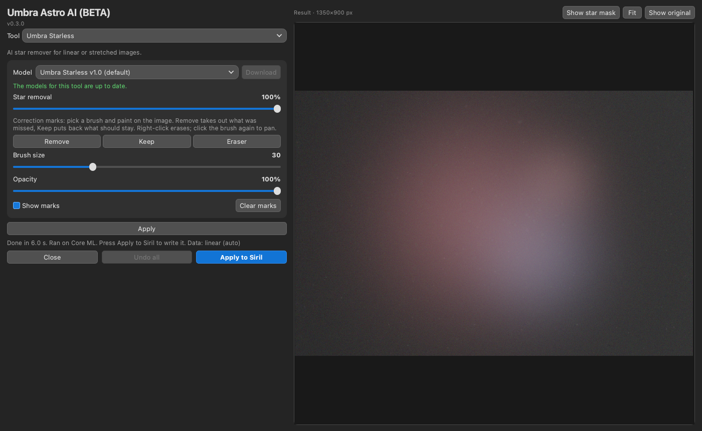
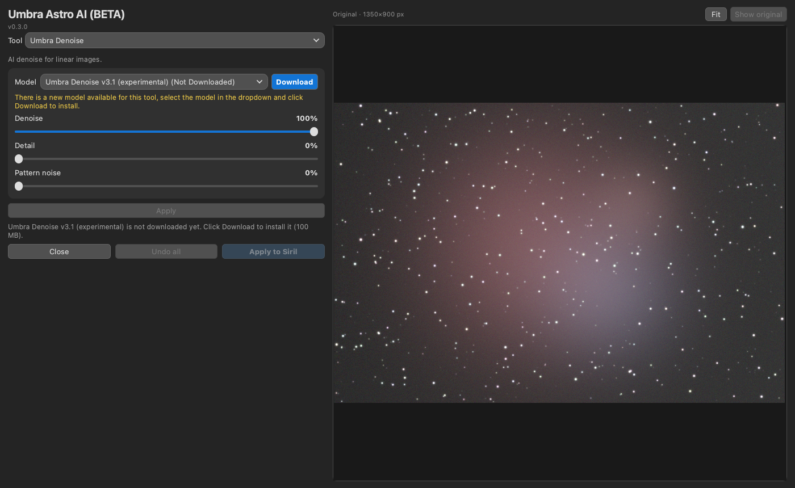

# Umbra Astro AI (BETA)

Umbra Astro AI puts four AI tools for [Siril](https://siril.org) into one script and one window: **Umbra Deblur**, **Umbra Denoise**, **Umbra Starless** and **Umbra Gradient**. It is a Siril Python script with AI models. It runs locally on your computer and is free. Pick the tool from the dropdown at the top. The processing code is the same as in the four single-tool scripts.

**Status: Beta (v0.3.0).** Expect rough edges.

*Screenshots (synthetic test image). The window has the controls on the left and the image on the right.*

## Download and install

1. Download the single file [`Umbra_Astro_AI.py`](https://raw.githubusercontent.com/Kishanhpatel/umbra-astro-ai/main/Umbra_Astro_AI.py) (also attached to the [latest release](https://github.com/Kishanhpatel/umbra-astro-ai/releases/latest)). Save it in any folder you like. Siril has no standard scripts folder name.
2. In Siril open **Preferences > Scripts**, add that folder, refresh the list, then run **Umbra Astro AI** from the Scripts menu.
3. First run: Siril installs the Python packages the script needs (numpy, onnxruntime, PyQt6, scipy, astropy). This can take a few minutes.
4. Choose a tool. If its model is not installed, the model drop-down lists it as "<model name> (Not Downloaded)". Select it and press **Download**, right of the drop-down. The file is checked with SHA-256 and saved in that tool's own folder next to the script: `Umbra Deblur`, `Umbra Denoise`, `Umbra Starless` or `Umbra Gradient`.

These are the same folders the single-tool scripts use, so models are shared: nothing downloads twice if you use both. The models themselves are published on the four tool repositories (see below), not on this one.

**Manual install.** Download the `.onnx` file from the tool's release page into that tool's folder. To use another folder, set the tool's variable: `UMBRA_DEBLUR_MODEL_DIR`, `UMBRA_DENOISE_MODEL_DIR`, `UMBRA_STARLESS_MODEL_DIR` or `UMBRA_GRADIENT_MODEL_DIR`. `UMBRA_<TOOL>_MODEL` can point at one specific model file.

**Updates.** Each time the script opens, it checks the published list (`models/models.json`) for a newer script and for new or changed models of the current tool. A line under the model row shows the result. In green: "The models for this tool are up to date." In yellow: "There is an update to this script available" or "There is a new model available for this tool, select the model in the dropdown and click Download to install." A model downloads only when you press **Download**. A newer script is shown as a link to the release page; the script never replaces itself. Nothing is sent about you or your computer (only a generic client name). With no network the installed models keep working. Set `UMBRA_OFFLINE=1` (or `UMBRA_<TOOL>_OFFLINE=1`) to turn the lookup off.

**Switching tools.** Only one model is kept in memory. Switching tools unloads the previous one. Each tool remembers its own model and settings. The window keeps its size when you switch tools or models.

**The window.** All four tools share one window. It has a fixed-width controls column on the left and a large image area on the right. The image area shows the current image (auto-stretched) as soon as the window opens. Scroll or pinch to zoom and drag to pan. Double-click the image or press **Fit** to fit the whole image. Hold down **Show original** (or the Space key) to compare with the original; release it to see the result again. The window keeps its size when you switch tools or models.

## The tools

### Umbra Deblur

AI deblur (deconvolution) for linear images. Measures the star shape, then sharpens in a number of passes. Controls: Aberration Removal Only, Sharpening (0 to 8), Protect star shapes, Automatic PSF / PSF Diameter (Automatic PSF is greyed out when the image has no stars, because the current models need stars to measure the PSF), Sharpen Stars, Halo Reduction. It runs on the whole image. Models: Umbra Deblur v1.0 (default) and v1.1 (experimental). Weak spot: very fine 1 to 4 pixel detail inside bright cores. Details: [umbra-deblur](https://github.com/Kishanhpatel/umbra-deblur).

### Umbra Denoise

AI noise removal for linear images, made for small-scope stacks and also fine on DSLR and mono. Controls: Denoise, Detail, Pattern noise. It runs on the whole image. Model: Umbra Denoise v3.1 (experimental). Weak spots: star cores come out about 1% brighter (not for photometry), some very faint structure is smoothed. Details: [umbra-denoise](https://github.com/Kishanhpatel/umbra-denoise).

### Umbra Starless

AI star remover for linear or stretched images, with the star layer as its own output. Controls: Star removal, **Show star mask**, and correction marks painted directly on the image: Remove, Keep and Eraser brushes (click a brush to paint, click it again to go back to pan and zoom; right-click erases; the middle mouse button pans), Brush size, Opacity (5 to 100%), Show marks and Clear marks. After each stroke the result updates by itself. The star removal is computed once per image and model, so marks and the Star removal slider update quickly. **Apply to Siril** always writes the starless image and saves the star layer as `starmask_<image file name>` next to the image (for example `starmask_M42.fits`; `_1`, `_2` is added instead of overwriting). Star removal below 100% keeps linear data linear. The Output and Data drop-downs and Auto-keep are not in the window; the command-line flags `--output`, `--data` and `--auto-keep` still exist. Models: Umbra Starless v1.0 (default) and v1.1 (experimental), plus a small separate Auto-keep model (about 3 MB), which is only used by the command-line `--auto-keep` option and is not offered by **Download**. If the StarNet2 command-line program is installed (found through Siril's StarNet setting or the usual install locations), the model list also shows "StarNet++ vX (installed)" and the script uses it for star removal. StarNet++ is not included or distributed with Umbra, and older versions that only take TIFF files are not supported. The script behaves exactly like the single Umbra Starless script. Weak spots: very bright stars can leave glows, and bright nebula cores (the Orion Nebula core) are partly cut; marks help there. Details: [umbra-starless](https://github.com/Kishanhpatel/umbra-starless).

### Umbra Gradient

AI background (gradient) removal for linear images, with no sliders and no options (use `--gradient-out` on the command line to save the gradient model). **Show gradient model** shows the subtracted background. Model: Umbra Gradient v7.0. Since v0.2.2 very bright stars with a huge round glow (e.g. Alnitak) keep their glow instead of leaving a dark hole, and the sky keeps its colour balance. Weak spots: diagonal bands are only partly removed, and it only handles smooth large-scale gradients. Details: [umbra-gradient](https://github.com/Kishanhpatel/umbra-gradient).

## Models

Since v0.2.0 the model files store their weights at half size (16-bit) and compute in full 32-bit precision, so the Denoise, Starless and Gradient results are bit-identical to the larger v0.1.x files. If you already have the larger file it keeps working and is not downloaded again.

| Tool | Name | File | Size |
|---|---|---|---|
| Deblur | Umbra Deblur v1.0 (default) | `umbra_deblur_v1.0.onnx` | 199 MB |
| Deblur | Umbra Deblur v1.1 (experimental) | `umbra_deblur_v1.1_experimental.onnx` | 199 MB |
| Denoise | Umbra Denoise v3.1 (experimental) | `umbra_denoise_v3.1_experimental.onnx` | 100 MB |
| Starless | Umbra Starless v1.0 (default) | `umbra_starless_v1.0.onnx` | 100 MB |
| Starless | Umbra Starless v1.1 (experimental) | `umbra_starless_v1.1_experimental.onnx` | 100 MB |
| Starless | Umbra Starless Auto-keep model v1.0 (extra, not a star remover) | `umbra_starless_critic_v1.0.onnx` | 3 MB |
| Gradient | Umbra Gradient v7.0 | `umbra_gradient_v7.0.onnx` | 112 MB |

`models/models.json` lists all six, with a `tool` field, and points at the release assets of the four tool repositories.

## Apply and Apply to Siril

Every tool has the same two buttons. **Apply** runs the tool on the whole image and shows the result in the image area; the image in Siril is not changed. **Apply to Siril** writes the result to the image in Siril. Use Siril's **Undo** to go back. If nothing changed since **Apply**, the result shown is reused. **Undo all** (bottom row, between **Close** and **Apply to Siril**) puts back the image as it was when the window opened. It becomes active after an **Apply to Siril**. There is no Preview button and no separate preview window. The settings used are written to the Siril log.

## GPU acceleration

The GPU is used by default whenever one can be used, and the CPU only as a fallback. Providers are tried in this order: CUDA (NVIDIA), DirectML (Windows), ROCm and MIGraphX (AMD on Linux), OpenVINO (Intel), Core ML (Mac), then CPU. Each one is checked against the CPU result on a small probe tile before it is used; if it fails or the result differs, the script falls back to the CPU. The status line says which one ran ("Ran on ..."). Set the tool's `..._CPU=1` variable (for example `UMBRA_DENOISE_CPU=1`) to force the CPU.

On first run the script installs the onnxruntime package that gives your system a GPU:

- **Mac:** `onnxruntime` (Core ML, Apple GPU, built in).
- **Windows:** `onnxruntime-directml` (any DirectX 12 GPU: NVIDIA, AMD or Intel; no extra downloads).
- **Linux with an NVIDIA GPU:** `onnxruntime-gpu` (CUDA). If the system has no CUDA 12 / cuDNN 9 libraries, NVIDIA's own pip packages of them are installed too (a one-time download of about 2 to 3 GB).
- **Linux with AMD or Intel graphics:** there is no GPU build that installs automatically, so these run on the CPU. If you install `onnxruntime-rocm`, `onnxruntime-migraphx` or `onnxruntime-openvino` yourself in Siril's Python, the script uses it.

## Testing

Be aware of what has and has not been tried. This is a beta.

Tested:
- macOS 26 on an Apple M3, with Core ML and with the CPU.
- Standalone (command line and window test) and inside Siril 1.4.5 run headless (`siril-cli` with `pyscript`): read the image, process it, write it back with an Undo state, save.
- The window was tested offscreen only.

NOT tested:
- Windows and Linux.
- CUDA, DirectML and ROCm (the code is written; please report what you see).
- Intel Macs.
- The interactive window inside the Siril GUI.

Parity numbers against the original PyTorch versions are in the four tool repositories. In short: the processing code is the same as in the single-tool scripts. Deblur is identical to the previous version on the test crops, and Denoise, Starless and Gradient differ by well under 0.01 noise sigma in nearly all cases. The exceptions are images under 512 px on a side with Denoise and Starless (small differences near the edges, up to about 1 sigma for Denoise).

## Layout

- `Umbra_Astro_AI.py`: the combined script (v0.3.0, ONNX Runtime, with model download and update check)
- `models/models.json`: manifest for all six models (with a `tool` field)
- `docs/screenshots/`: panel screenshots
- `LICENSE`, `LICENSE-MODELS.md`: licenses

## Contact

Bugs or questions: umbraastrolabs@gmail.com, or open an issue on GitHub.

## License

- Script: GPL-3.0-only (see `LICENSE`).
- Models: CC BY-NC-SA 4.0, non-commercial (see `LICENSE-MODELS.md`).
