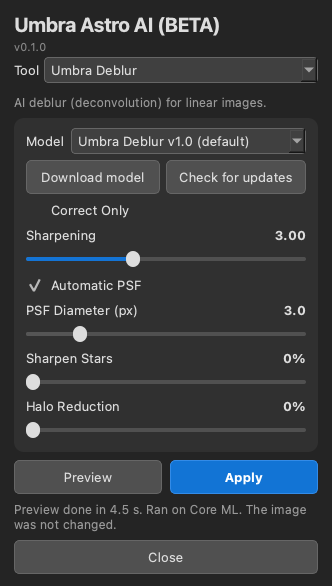
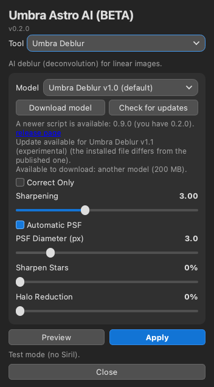
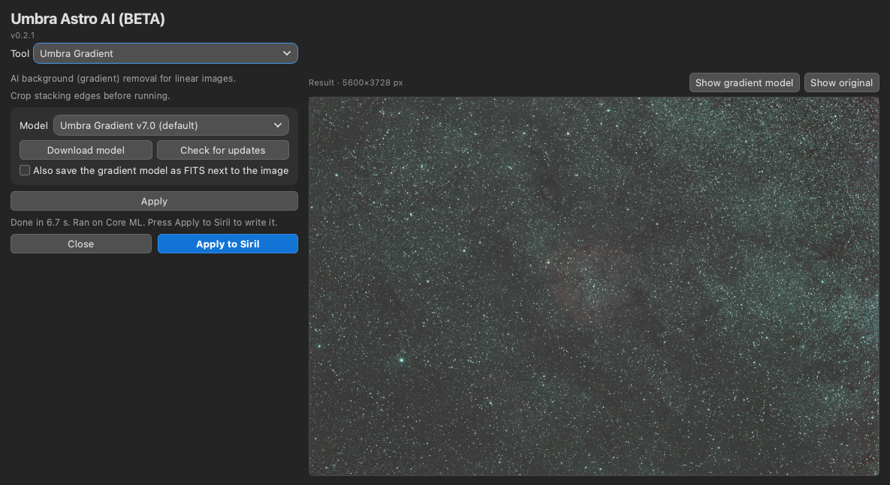

# Umbra Astro AI (BETA)

Umbra Astro AI puts four AI tools for [Siril](https://siril.org) into one script and one window: **Umbra Deblur**, **Umbra Denoise**, **Umbra Starless** and **Umbra Gradient**. It is a Siril Python script with AI models. It runs locally on your computer and is free. Pick the tool from the dropdown at the top. The processing code is the same as in the four single-tool scripts.

**Status: Beta (v0.2.1).** Expect rough edges.

## Download and install

1. Download the single file [`Umbra_Astro_AI.py`](https://raw.githubusercontent.com/Kishanhpatel/umbra-astro-ai/main/Umbra_Astro_AI.py) (also attached to the [latest release](https://github.com/Kishanhpatel/umbra-astro-ai/releases/latest)). Save it in any folder you like. Siril has no standard scripts folder name.
2. In Siril open **Preferences > Scripts**, add that folder, refresh the list, then run **Umbra Astro AI** from the Scripts menu.
3. First run: Siril installs the Python packages the script needs (numpy, onnxruntime, PyQt6, scipy, astropy). This can take a few minutes.
4. Choose a tool. If its model is not installed, press **Download model**. The file is checked with SHA-256 and saved in that tool's own folder next to the script: `Umbra Deblur`, `Umbra Denoise`, `Umbra Starless` or `Umbra Gradient`.

These are the same folders the single-tool scripts use, so models are shared: nothing downloads twice if you use both. The models themselves are published on the four tool repositories (see below), not on this one.

**Manual install.** Download the `.onnx` file from the tool's release page into that tool's folder. To use another folder, set the tool's variable: `UMBRA_DEBLUR_MODEL_DIR`, `UMBRA_DENOISE_MODEL_DIR`, `UMBRA_STARLESS_MODEL_DIR` or `UMBRA_GRADIENT_MODEL_DIR`. `UMBRA_<TOOL>_MODEL` can point at one specific model file.

**Updates.** **Check for updates** compares your installed models for the current tool and the script version with the published list (`models/models.json`). A new or changed model downloads only when you press the button. A newer script is shown as a link to the release page; the script never replaces itself. Nothing is sent about you or your computer (only a generic client name). With no network the installed models keep working. Set `UMBRA_OFFLINE=1` (or `UMBRA_<TOOL>_OFFLINE=1`) to turn the lookup off.

**Switching tools.** Only one model is kept in memory. Switching tools unloads the previous one. Each tool remembers its own model and settings.

## The tools

### Umbra Deblur

AI deblur (deconvolution) for linear images. Measures the star shape, then sharpens in a number of passes. Controls: Correct Only, Sharpening (0 to 8), Protect star shapes, Automatic PSF / PSF Diameter, Sharpen Stars, Halo Reduction. Models: Umbra Deblur v1.0 (default) and v1.1 (experimental). Weak spot: very fine 1 to 4 pixel detail inside bright cores. Details: [umbra-deblur](https://github.com/Kishanhpatel/umbra-deblur).

### Umbra Denoise

AI noise removal for linear images, made for small-scope stacks and also fine on DSLR and mono. Controls: Denoise, Detail, Pattern noise. Model: Umbra Denoise v3.1 (experimental). Weak spots: star cores come out about 1% brighter (not for photometry), some very faint structure is smoothed. Details: [umbra-denoise](https://github.com/Kishanhpatel/umbra-denoise).

### Umbra Starless

AI star remover for linear or stretched images, with the star layer as its own output. Controls: Star removal, Auto-keep (optional; results vary by image), Data, Output, save star layer. **Preview** removes the stars from the whole image once and opens an editor with correction marks: Remove and Keep brushes, Eraser, Undo stroke, Clear marks, Show marks, **Apply Remove marks after each stroke**, **Apply marks**, zoom and pan, Show original (hold, or Space) and Show star layer. Star removal and Keep marks update at once; Remove marks re-run the network only where you painted. **Apply** reuses the stored result and the marks. Models: Umbra Starless v1.0 (default) and v1.1 (experimental), plus a small separate Auto-keep model (about 3 MB, only needed for Auto-keep; **Download model** offers it, and with the box ticked but the file missing the status line says "Auto-keep needs the Auto-keep model. Press Download model."). The script behaves exactly like the single Umbra Starless script. Weak spots: very bright stars can leave glows, and bright nebula cores (the Orion Nebula core) are partly cut; marks help there. Details: [umbra-starless](https://github.com/Kishanhpatel/umbra-starless).

### Umbra Gradient

AI background (gradient) removal for linear images, with no sliders. Model: Umbra Gradient v7.0. Weak spots: diagonal bands are only partly removed, and it only handles smooth large-scale gradients. Details: [umbra-gradient](https://github.com/Kishanhpatel/umbra-gradient).

## Models

Since v0.2.0 the model files store their weights at half size (16-bit) and compute in full 32-bit precision, so the Denoise, Starless and Gradient results are bit-identical to the larger v0.1.x files. If you already have the larger file it keeps working and is not downloaded again.

| Tool | Name | File | Size |
|---|---|---|---|
| Deblur | Umbra Deblur v1.0 (default) | `umbra_deblur_v1.0.onnx` | 199 MB |
| Deblur | Umbra Deblur v1.1 (experimental) | `umbra_deblur_v1.1_experimental.onnx` | 199 MB |
| Denoise | Umbra Denoise v3.1 (experimental) | `umbra_denoise_v3.1_experimental.onnx` | 100 MB |
| Starless | Umbra Starless v1.0 (default) | `umbra_starless_v1.0.onnx` | 100 MB |
| Starless | Umbra Starless v1.1 (experimental) | `umbra_starless_v1.1_experimental.onnx` | 100 MB |
| Starless | Umbra Starless Auto-keep model v1.0 (extra, not a star remover) | `umbra_starless_critic_v1.0.onnx` | 3 MB |
| Gradient | Umbra Gradient v7.0 | `umbra_gradient_v7.0.onnx` | 112 MB |

`models/models.json` lists all six, with a `tool` field, and points at the release assets of the four tool repositories.

## Preview and Apply

**Preview** opens a separate, resizable window with a region of the image before and after (Siril selection of at least 64 px, else a centred 768 x 768 crop). For Gradient the image is part of the main window instead: **Apply** shows the result of the whole image there (Siril is not changed), **Show original** (hold) and **Show gradient model** sit above the image, and **Apply to Siril** next to **Close** writes the result. **Apply** replaces the image in Siril. Use Siril's **Undo** to go back. The settings used are written to the Siril log.

## GPU acceleration

The GPU is used by default whenever one can be used, and the CPU only as a fallback. Providers are tried in this order: CUDA (NVIDIA), DirectML (Windows), ROCm and MIGraphX (AMD on Linux), OpenVINO (Intel), Core ML (Mac), then CPU. Each one is checked against the CPU result on a small probe tile before it is used; if it fails or the result differs, the script falls back to the CPU. The status line says which one ran ("Ran on ..."). Set the tool's `..._CPU=1` variable (for example `UMBRA_DENOISE_CPU=1`) to force the CPU.

On first run the script installs the onnxruntime package that gives your system a GPU:

- **Mac:** `onnxruntime` (Core ML, Apple GPU, built in).
- **Windows:** `onnxruntime-directml` (any DirectX 12 GPU: NVIDIA, AMD or Intel; no extra downloads).
- **Linux with an NVIDIA GPU:** `onnxruntime-gpu` (CUDA). If the system has no CUDA 12 / cuDNN 9 libraries, NVIDIA's own pip packages of them are installed too (a one-time download of about 2 to 3 GB).
- **Linux with AMD or Intel graphics:** there is no GPU build that installs automatically, so these run on the CPU. If you install `onnxruntime-rocm`, `onnxruntime-migraphx` or `onnxruntime-openvino` yourself in Siril's Python, the script uses it.

## Testing

Be aware of what has and has not been tried. This is a beta.

Tested:
- macOS 26 on an Apple M3, with Core ML and with the CPU.
- Standalone (command line and window test) and inside Siril 1.4.5 run headless (`siril-cli` with `pyscript`): read the image, process it, write it back with an Undo state, save.
- The window was tested offscreen only.

NOT tested:
- Windows and Linux.
- CUDA, DirectML and ROCm (the code is written; please report what you see).
- Intel Macs.
- The interactive window inside the Siril GUI.

Parity numbers against the original PyTorch versions are in the four tool repositories. In short: the processing code is the same as in the single-tool scripts. Deblur is identical to the previous version on the test crops, and Denoise, Starless and Gradient differ by well under 0.01 noise sigma in nearly all cases. The exceptions are images under 512 px on a side with Denoise and Starless (small differences near the edges, up to about 1 sigma for Denoise).

## Layout

- `Umbra_Astro_AI.py`: the combined script (v0.2.1, ONNX Runtime, with model download and update check)
- `models/models.json`: manifest for all six models (with a `tool` field)
- `docs/screenshots/`: panel screenshots
- `LICENSE`, `LICENSE-MODELS.md`: licenses

## Contact

Bugs or questions: umbraastrolabs@gmail.com, or open an issue on GitHub.

## License

- Script: GPL-3.0-only (see `LICENSE`).
- Models: CC BY-NC-SA 4.0, non-commercial (see `LICENSE-MODELS.md`).
